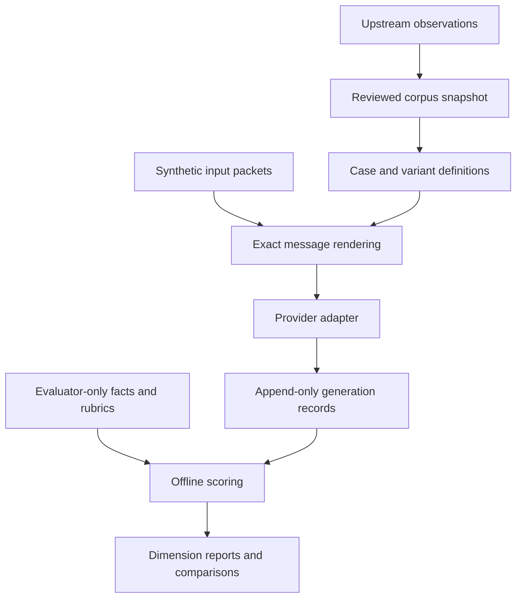

# Architecture and implementation decisions

Status: proposed architecture, with narrow foundation contracts implemented. No network runner exists.

## Language and dependencies

Choose Python 3.11+ for local inference metadata, mature provider SDK options, validation, statistical analysis, packaging and compatibility with Inspect/lm-evaluation-harness. JSON is the initial case format: universally readable, schema-validatable and free of YAML implicit typing. Markdown holds rubrics/design context. Standard library argparse/unittest is sufficient for current offline checks.

When execution is added, prefer Pydantic 2 for strict typed loading and HTTPX for explicit HTTP behavior. Typer is optional for the public CLI; use it if command complexity warrants it. Use native SDKs only when they materially reduce protocol risk (Anthropic is the first candidate). Do not add LangChain, LiteLLM, Inspect and another orchestration layer simultaneously. Dependencies are not installed simply because they are proposed. A tested lockfile and supported Python matrix are release gates.

Inspect is the strongest alternative execution engine. Before implementing complex multi-turn or provider orchestration, prototype mapping one case to Inspect Dataset/Solver/Scorer plus a lossless result export. Adopt it behind the runner boundary if it preserves setting provenance, raw attempts and status semantics with less code. Until that checkpoint, the project-owned source/case/result formats are stable conceptual boundaries; the executor is replaceable. This is a deliberate small-core decision, not a claim that reinventing every scheduler is useful.

## Data flow



These boundaries prevent an upstream update, judge change or report-generation step from silently changing a model experiment.

## Components and interfaces

| Component | Responsibility | Forbidden shortcut |
|---|---|---|
| Discovery/import | Enumerate, fetch, hash, extract and stage observations | Mutate a released case or follow model-supplied URLs |
| Corpus catalog | Identify immutable source bundles and status evidence | Infer verification from profession tags |
| Case loader | Strict types, references, fixture visibility, variant lineage | Execute template code or tolerate unresolved placeholders |
| Renderer | Literal replacements, deterministic attachment framing, exact transcript | Add helpful instructions or source material only for one model |
| Dialogue controller | Fixed scripts, bounded stages and stop rules | Hidden LLM simulator or answer-dependent coaching |
| Provider | Translate request to documented API; return raw visible output/metadata | Grade, silently drop settings, switch model |
| Runner | Scheduling, attempt journaling, timeouts, repetition, budget | Retry low-quality answers or erase failures |
| Evaluators | Separate independent measurements with evidence | Universal truth inferred from a string match |
| Reporters | Terminal/JSON/JSONL/CSV/Markdown views of saved records | Silently rejudge or average incompatible cases |

`src/bureaucracybench/providers/contracts.py` contains a minimal typed protocol, not a transport implementation. `schemas/` contains draft external contracts. Cross-record invariants are specified below and partially checked by the foundation validator; schema presence is not a completed loader.

## Case identity and rendering

Case = task + scenario + input condition + variant + dialogue + evaluators. The source prompt remains independent. Case IDs such as `BB-GANTT-001` are permanent. Increment revisions when a binding, instruction, input, oracle, rubric, parser or reference materially changes. A new scenario becomes a new sample identity; repetitions are not new tasks.

A library case references exact source ID and prompt digest. Literal replacements enumerate exact original strings, including upstream backslashes if present. Apply replacements in declared order, verify occurrence counts, then append model-visible attachments in their declared order. Record the rendering version, complete rendered messages and hash. No generic regex replacing every bracket: source citations, example tables and ordinary parentheses/brackets are not placeholders.

For the four draft examples, send `original_prompt.strip()` after explicit replacements as the first user message. For `attachments_at_start`, append `\n\n<benchmark_documents>\n` + JSON serialization of each fixture's selected `input[input_key]` packet (`ensure_ascii=False`, `sort_keys=True`, `indent=2`) joined by `\n\n` + `\n</benchmark_documents>`. Those transport delimiters are disclosed adaptation; they do not add new scoring demands. `scripted_after_request` sends that same input serialization in the prescribed later user turn. Record any future change of framing as a rendering version change. Never serialize `oracle`.

## Multi-turn policy

First support fixed user messages by turn, with a separate workflow scorer. If a model asks an unexpected question, the next scripted packet still arrives as scheduled, prefaced by a fixed “Here is the available information for this stage.” No tailored answer generation. This is reproducible but imperfect conversational realism, which must be reported. Some strict approval workflows require a later finite-state controller; their transition predicates need reviewed semantic evaluation, not a question-mark regex.

Store all turns and reasons for ending (`completed`, `max_turns`, `user_script_exhausted`, `provider_error`, `context_overflow`). A premature final answer remains in the transcript and can fail workflow criteria; do not restart it. The procurement draft evaluates its first inquiry separately from the final strategy. A source's request to create a Word file is `unsupported_capability` in the text-only runner.

## Result persistence

One run directory:

```text
manifest.json       # run/config/code/corpus identities and plan
samples.jsonl       # one terminal record per case/variant/repetition
attempts.jsonl      # durable journal, including retry/error events
judgments.jsonl     # optional separate human/model ratings
summary.json        # derived per-dimension metrics and coverage
report.md           # derived human view
metrics.csv         # long-form metric rows, never raw multiline output
```

Use UTF-8, UTC ISO-8601 timestamps, stable string IDs and explicit units. Tokens/cost/latency unavailable = null, never 0. Durations use monotonic clocks and milliseconds; timestamps use UTC wall clocks. Record currency, price-table date, actual versus estimated charge, cache discounts and judge costs separately. JSONL writers must flush complete lines; resume discards only an explicitly detected incomplete final line after recording recovery. Write manifests atomically. v0.1 is local files, not a database.

## Preflight and failures

Validate source/case status, references/hashes, synthetic input flags, model capabilities, context budget, settings and secrets before scheduling. `full` records a planned inventory including skipped/incompatible cases so coverage cannot inflate. Fail-fast for invalid experiment configuration; continue across independent operational sample failures unless the configured error budget is exceeded.

Defaults for initial implementation: concurrency 1 per endpoint; explicit request timeout; at most two transport retries after the first attempt; bounded exponential backoff with jitter and Retry-After support; total run request/spend ceilings. Authentication/invalid parameter errors are not transient. Never silently cut documents or turn off reasoning on overflow. A timeout may already be billable: record unknown charge and request ID; exactly-once remote generation is not guaranteed.

## Caching and comparison

Generation cache key includes corpus/case/prompt/fixture/reference hashes, exact messages, endpoint identity, model/revision/runtime/quantization/chat-template digests, transmitted parameters, seed, repetition and rendering/adapter versions. Do not share caches between unspecified aliases or independent repetitions. Cached replay cannot measure latency or independent variance. Scoring cache separately includes output hash, evaluator/rubric/reference/judge identities.

Comparison joins exact sample identities and evaluator versions, reports their intersection and excluded observations, and separates changed prompt/corpus experiments from matched model comparisons. Same-token budgets are not equal compute budgets across tokenizers or hidden reasoning. Record actual budgets and interpret accordingly.

## Open questions

Standards-based schema checks validate the draft examples; strict runtime loaders, result-instance conformance, dependency locking and all live transports remain to implement. Native structured-output enforcement is an explicit treatment, not the default for a government prompt requesting a table. Full file rendering, tools, retrieval and native runtime telemetry are later capability tracks.
